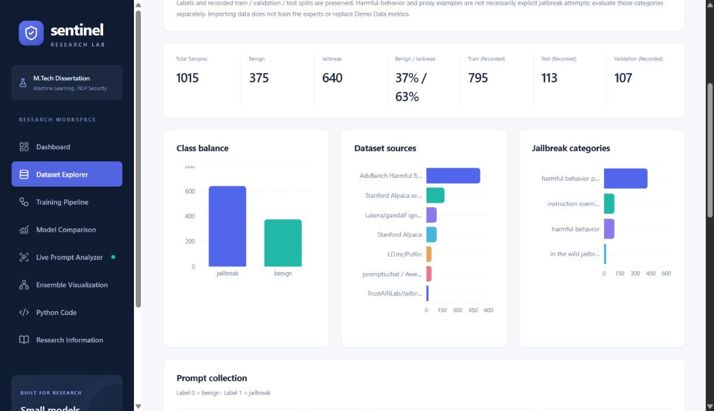

# Full-site functional and text audit — 11 October 2026

Result: **25 frontend tests passed, 53 backend tests passed, production build passed.**

Reviewed all eight application pages, their authored text and panels, and the connected API behavior. This audit extends the earlier report; it does not claim exhaustive testing of every possible input or independently verify dataset source claims.

## Browser coverage

| Page / panel | Checks performed | Result |
| --- | --- | --- |
| Dashboard | Eight overview cards, real dataset vs demo metrics labels, class distribution, model chart, pipeline, session-history empty state and navigation | Passed |
| Dataset Explorer | Loaded filename and provenance, recorded counts/splits, three charts, next/previous, combined class/source/category filters, literal search, empty state, disabled pagination and expanded provenance | Passed |
| Training Pipeline | All 12 stage buttons, corresponding detail headings, input/output text, conceptual diagram; recorded split presentation corrected | Passed |
| Model Comparison | All seven dropdown options, eight metric rows and eight confusion matrices; grouped quality chart, latency and scalar ROC-AUC panels; demo labels | Passed |
| Live Prompt Analyzer | Blank input disabled, benign and jailbreak examples, all four strategies, threshold keyboard control, stale-result warning, normalized text, animated steps, scores, allow/block output and Clear | Passed |
| Feedback collection | History next/previous, review editor/category selection/cancel; save and failure branches plus export round-trip tested in isolated automated fixtures | Passed |
| Ensemble Visualization | All four selectable expert roles, demo rules, saved-result dropdown, contributions, strategy text, threshold/decision agreement, diagram, no duplicate prompt input | Passed |
| Python Code | All six snippets inspected; all six Copy buttons reached Copied; clipboard denial and overlapping confirmation timers covered by tests | Passed |
| Research Information | Title, objective, proposed methodology, problem statement, workflow, all metric definitions, academic scope | Passed |
| Layout | Light/dark themes, sidebar, secondary navigation, page headings, mobile and laptop widths | Passed |
| API interruption | Backend stopped intentionally: dashboard showed API offline, Unavailable, Retry and Reconnect. Restarted backend and Reconnect restored data and API connected | Passed |

Responsive checks covered all eight pages at 390 × 844 and 1366 × 768. After fixes, no page-level horizontal overflow was measured. Temporary viewport and dark-theme changes were restored. Browser error/warning inspection was empty during normal connected operation; the intentional API outage correctly produced request failures.

## Fixes made during this audit

1. Fixed mobile Ensemble overflow caused by the saved-analysis selector and grid item's intrinsic minimum width.
2. Allowed long provenance badges and explanatory text to wrap.
3. Changed long source/category charts to horizontal bars with shortened axis labels; full source names remain in filter options, records and chart tooltips.
4. Added substantive Accuracy, ROC-AUC and Inference Time definitions; those tooltips previously repeated their names.
5. Displayed imported train/validation/test counts on the training split stage, with an explicit distinction between CSV assignments and completed training.
6. Added selected-stage accessibility state and navigation expanded state. Brand and secondary research links now close the mobile menu.
7. Corrected wording that implied experts had already learned from imported data or that a complete training script existed. Dashboard expert status now distinguishes simulated roles from loaded classifiers.
8. Hardened imported metric validation: reject missing/invalid numeric values, non-finite or negative timing, duplicate/empty names and malformed confusion matrices. A bad metrics file produces an actionable HTTP 503; it does not silently display fabricated results or disable dataset access.
9. Updated README descriptions of the dedicated Ensemble page, active dataset and file selection order.

## Observed demo decisions

The UI's example jailbreak prompt at threshold 0.50 gave weighted-average 0.928, average 0.920, majority-voting 1.000 and maximum-confidence 0.960, all blocked. Keyboard-setting threshold 0.95 changed the weighted-average decision at 0.928 to benign/allow. A separate combined-pattern probe scored 0.960 and was blocked at 0.95. A benign cloud-computing example scored 0.120 and was allowed at 0.50.

These are **simulated pattern-rule outputs**, not model accuracy measurements and not successful jailbreaks of a connected LLM. Browser test submissions remain in local analysis history, pending human label review. Existing training labels were not altered. Save/correction/export tests use temporary stores or mocked APIs.

## Automated coverage and limits

The 78 tests cover resource refresh/stale responses, pagination retention, combined filters, first/last/empty states, retry, review save/cancel/failure, clipboard failure, prompt constraints, strategy/threshold submission, all ensemble strategies at boundary thresholds, CSV schema aliases/provenance, supplied-dataset selection without double-counting, expert catalog consistency, joblib loading/fallback using temporary fitted fixtures, valid and malformed metric files, SQLite persistence, label validation and deduplicated CSV round-trips.

One existing test dependency deprecation warning remains (Starlette TestClient/httpx); tests pass. Large-dataset load testing, every browser engine, statistical model effectiveness and independent external-source verification are outside this run. No dissertation-trained expert artifacts are currently installed; inference and performance results retain Demo labels. Automated tests of a temporary fitted estimator do not make the live application a trained system.

